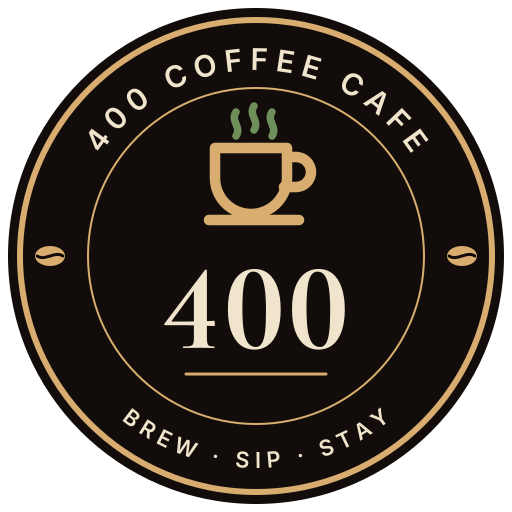

# 400 Coffee Cafe: logo

The café had no logo, so we designed one. Amit chose **concept A, The Seal**, dark version, on 14 Nov 2026. This is the café's (tenant's) brand, not Brew Haven's: it is set in the tenant's `branding.logoUrl`, never hard-coded in the app.

## Files

All files are in `apps/customer/public/brands/400-coffee/` and are served by the customer app at `/brands/400-coffee/…`. They are plain SVG with the lettering already turned into shapes, so they look the same everywhere without the fonts installed.

| File | Use |
|---|---|
| `logo.svg` | Main logo: espresso seal with brass ring. Customer app, social profile, signage, cups and sleeves |
| `logo-light.svg` | Cream seal with roasted-brown ring, for when the dark seal clashes with a light background |
| `logo-mono.svg` | One colour (black, transparent background): rubber stamps, thermal receipts, engraving, embossing |
| `icon.svg` | Rounded-square app or social icon: the cup and "400" inside the ring, without the small ring text |

Keep clear space around the seal of at least a quarter of its width, and don't show it smaller than 40 px (on screen) or 18 mm (in print); below that use `icon.svg`.

## Colours

The seal uses the Brew Haven customer palette, so it sits naturally in the app.

| Name | Hex | Where |
|---|---|---|
| Espresso | `#120D0A` | Seal background |
| Brass | `#D9AD70` | Ring, cup, rule |
| Parchment | `#F1E4CC` | "400" and ring lettering |
| Leaf | `#6F8F5A` | Steam |
| Roasted | `#57331F` | Ring and cup on the light version |
| Cream | `#FBF6EC` | Light version background |

## Fonts

Both are free Google Fonts under the SIL Open Font License, fine for commercial print and web.

| Font | Where |
|---|---|
| Cormorant Garamond Bold, lining figures | "400" |
| Inter Regular, tracked capitals | "400 COFFEE CAFE" and "BREW · SIP · STAY" around the ring |

## Making changes

The logo is generated from a small Python script (fontTools turns the text into outlines). The script and the other concepts we showed (B Bean Zeros, C Latte Art) are kept in the project's shared files under `brand/logo-concepts/`.

## In the app

* The seed sets `logoUrl` to `/brands/400-coffee/logo.svg` for the 400 Coffee demo business.
* The customer welcome screen shows the seal above the café name. A café without a `logoUrl` shows the name alone, as before. The menu header keeps the name only: at header size the ring lettering can't be read and the name would wrap on phones.
* The images are decorative (`alt=""`) because the café name is always written next to them.
* Not yet on receipts or the QR poster: those are printed from the staff app, which is on a different address. That needs the logo stored as a full URL or uploaded through Settings, planned with the owner logo upload.
